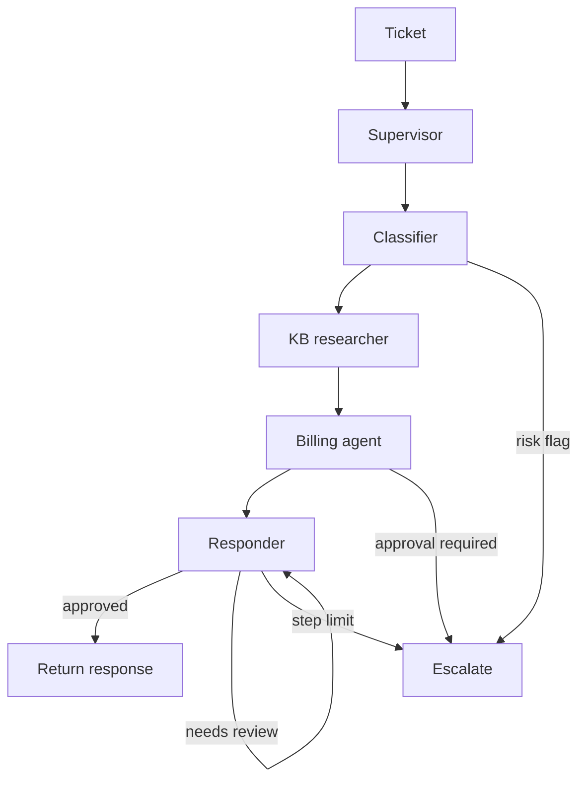
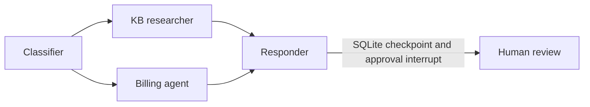
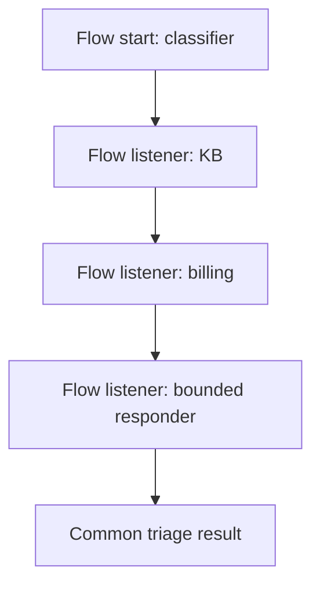
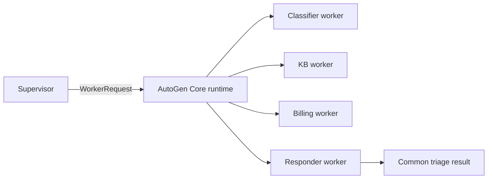
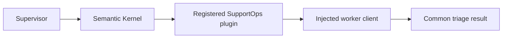
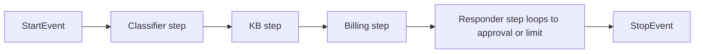

# P01 — Multi-agent orchestration

This project implements SupportOps ticket triage with a deterministic supervisor-worker runner and a common `TriageRunner` contract. Runtime `Ticket` and `TriageDecision` remain P01-local compatibility doubles. P01 consumes the approved P00 1.0.1 wheel in an isolated environment to export its versioned golden set; version, source commit, SHA-256, and consumer command are in `docs/harness/sources.lock.json`. The P01 runtime uses `LLM_MODE=fake` and makes no model-provider calls.

## Architecture

### Core supervisor-worker (implemented)



### LangGraph (implemented)



### CrewAI Flow (implemented)



### AutoGen classic (implemented)



### Semantic Kernel classic (implemented)



### LlamaIndex Workflows (implemented)



## Run

```powershell
uv sync --group frameworks
uv run --group frameworks python scripts/check_fast.py
$env:PYTHONPATH = "src"
uv run --group frameworks python -m supportops_agents.demo
uv run --group frameworks python -m supportops_agents.comparison --output artifacts/runs/latest
```

`uv run --group frameworks python scripts/check_full.py` runs fast tests, the synthetic comparison, the offline demo, and project structure checks. Checks save command, exit code, and output in `artifacts/evidence/`.

## Comparison status

| Runner | Status | Control-flow use case | Accuracy, tokens, cost, latency |
|---|---|---|---|
| Core | Executed | Small dependency-free supervisor loop | PENDING |
| LangGraph | Executed | Graph parallelism, retry, SQLite resume, HITL | PENDING |
| CrewAI Flow | Executed | Event-driven Flow listeners and bounded responder | PENDING |
| AutoGen classic | Executed | AutoGen Core runtime routed specialist worker messages | PENDING |
| Semantic Kernel classic | Executed | Registered kernel plugin for worker dispatch | PENDING |
| LlamaIndex Workflows | Executed | Typed workflow events and bounded responder loop | PENDING |

The generated `COMPARISON.md` exercises all 60 versioned P00 cases in fake mode and reports per-case action/category behavior and unsupported P00 semantics. It distinguishes framework-native features from orchestration supplied by P01 wrappers. This is a deterministic control-flow comparison, not agent quality. Accuracy, tokens, cost, and model latency remain `PENDING`. See [ADR-001](docs/decisions/ADR-001-framework-scope.md) for why the Microsoft successor is not silently substituted for AutoGen/Semantic Kernel.

## Limitations and decisions

- P01 runtime uses local `Ticket` and `TriageDecision` doubles documented in `src/supportops_agents/contracts.py`; only comparison fixture export uses the installed P00 wheel. A shared runtime install is blocked by P00's Pydantic 2.14.1 pin and CrewAI's `<2.13` constraint.
- Comparison metrics for genuine model runs remain `PENDING`; all adapters have fake-mode contract coverage only.
- No live/replay provider mode, production traces, HTTP API, auth, queue, or formal agent evaluation is included.
- Python runtime observed: 3.13.12. Core has no third-party dependencies. Framework package versions are pinned in `uv.lock` and recorded in `docs/harness/sources.lock.json`.
